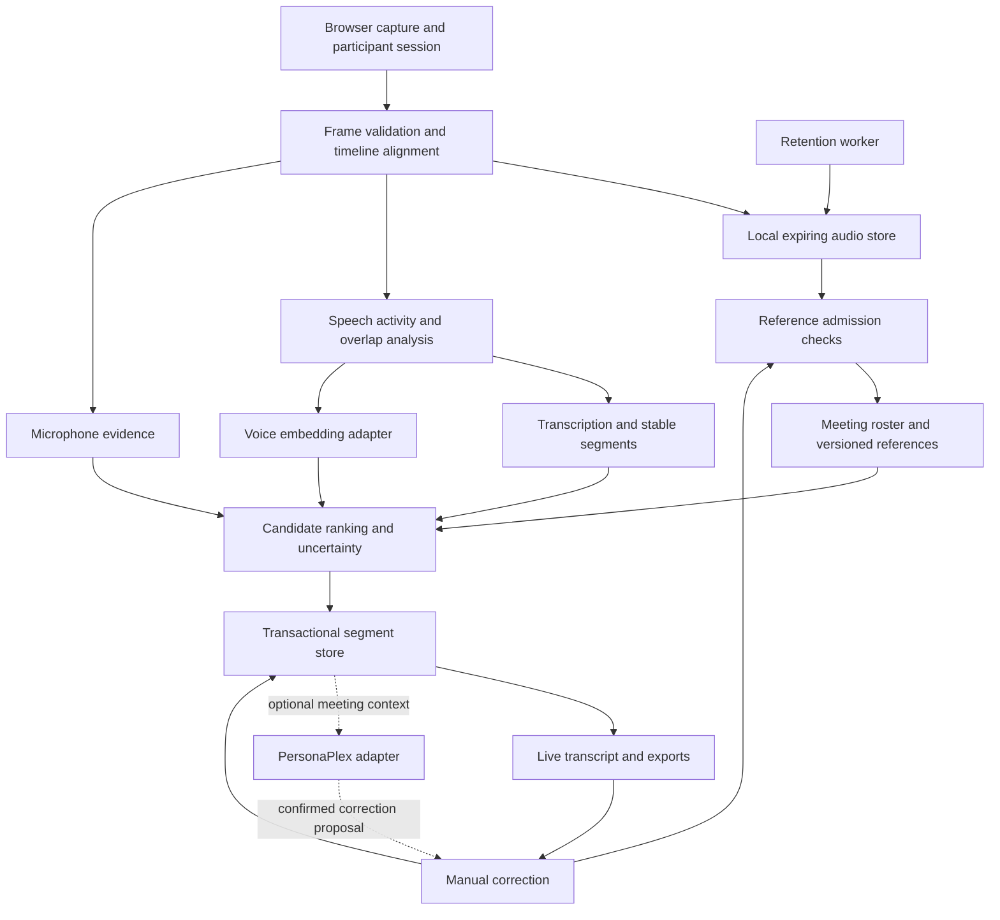

# Voice-split technical requirements and proposed design

**Status:** Proposed design; not implemented  
**Date:** 31 October 2026  
**Product requirements:** [PRD.md](PRD.md)  
**Inspected baseline:** local v0.1.1 source

## 1. Objective and design boundaries

Implement word-independent attribution of short speech, speech-duration-based enrollment, meeting-scoped candidate selection, editable assignments, controlled reference learning, and local audio retention. Add microphone evidence once real multi-device capture is available. Keep PersonaPlex as an optional later service.

The PRD records agreed product behavior. API shapes, schema, module boundaries, scheduling, and evaluation parameters below are engineering proposals. Model quality, optimal fusion weights, and short-clip performance remain experimental; no accuracy guarantee follows from this design.

## 2. Existing implementation

| Area | Current source and behavior | Required change |
| --- | --- | --- |
| Browser capture | `static/app.js`, `static/pcm-worklet.js`: microphone capture and PCM streaming; per-page device identifier | Participant association, versioned frames, speech progress, correction controls |
| API | `voice_split/server.py`: FastAPI, localhost Host/Origin checks, one inference lock | Add roster, correction, review, reference, and audio lifecycle APIs |
| Models | `voice_split/engines.py`: faster-whisper `base.en` CPU/int8 and SpeechBrain ECAPA CPU | Preserve baseline; introduce explicit short-clip outcomes and evaluate alternatives only against held-out data |
| Enrollment | `voice_split/identification.py`: ASR speech spans and normalized window embeddings | Measure actual speech with VAD; collect 15–20 seconds and preserve reference provenance |
| Matching | `voice_split/profiles.py`: global candidates, cosine ranking, 0.70 cutoff and 0.08 margin | Meeting-scoped ranking independent of acceptance cutoff |
| Streaming | `voice_split/streaming.py`: three-second input windows, two-second decode context, stable-word emission | Stable segment revisions, independent attribution spans, explicit change/overlap handling |
| Microphones | `voice_split/rooms.py`: strongest-RMS stream per coarse window, maximum six devices | Preserve source evidence, align devices, avoid interpreting loudness as identity |
| Persistence | `profiles.json` plus SQLite rooms and JSON segment payloads | Transactional reference provenance, corrections, roster, revisions, and retention state |
| Audio | Raw audio not persisted | Bounded local audio storage with expiry and approved reference extraction |

The two-second matching gate still exists in v0.1.1. Existing saved aggregates cannot be decomposed into their original samples, and old meeting audio cannot be recovered from transcript exports.

## 3. Target architecture

Keep one local FastAPI service, SQLite, and a bounded inference worker initially. Extend existing owners rather than introducing distributed services for core features. Proposed focused modules are `attribution.py` for ranking, `references.py` for sample provenance/admission, and `audio_store.py` for media lifecycle. Model inference remains in `engines.py`; persistence owns transactions; handlers orchestrate these operations.

## 4. Capture, speech boundaries, and timing

### 4.1 Single-device baseline

- Retain canonical 16 kHz mono audio for transcription and speaker inference, with the conversion path version recorded.
- Run a streaming VAD adapter over short frames. Choose and pin the implementation through a fixture evaluation; energy alone is not a reliable count of spoken seconds.
- Enrollment progress is the union of detected speech intervals, excluding silence. Browser progress may be provisional; the server validates the final usable speech duration before saving.
- Accumulate 15–20 seconds of usable initial speech, continuing across prompts if necessary. Keep recording/upload resource limits explicit and independent of the meeting matching policy.
- Preserve timestamps into original audio when selecting speech. Avoid counting context overlap twice.
- Retain ASR context for text quality, but do not automatically embed the entire ASR context as the current speaker. Use the utterance's audio span; extend context only when continuity evidence supports the same speaker.

### 4.2 Real multi-device capture

Use an explicitly enabled local-network deployment with HTTPS/WSS, a browser-trusted certificate, expiring room join credentials, and server-assigned device sessions. Do not simply remove localhost restrictions or bind publicly. Browser capture from another laptop needs a secure, reachable origin.

Proposed versioned frame metadata: protocol version, device session ID, sequence number, first sample index, sample count, sample rate, and capture monotonic time. Bind participant identity to the authenticated session on the server, not to arbitrary frame fields.

Estimate clock offset and drift with periodic exchanges and sample counters. Buffer a bounded alignment window; detect gaps, duplicates, reconnects, and late packets. Use aligned intervals when comparing microphones. Mark excessive timing uncertainty and disable cross-device evidence for those intervals rather than fabricating alignment.

Preserve per-source speech activity and quality evidence before selecting transcription audio. Detect duplicated pickup where feasible; avoid emitting the same contribution once per microphone. Simultaneous independent speech must be represented as separate source segments when separable, or flagged as overlap when not. The existing highest-RMS selection is a baseline fallback, not source separation or echo cancellation.

## 5. Voice references and enrollment

Use stable participant IDs, independent of display names. Store approved reference contributions individually with their model and preprocessing versions. Derive an initial profile centroid as the normalized mean of active, normalized contribution embeddings. Keep per-sample vectors so a later evaluated aggregation policy can replace that baseline without losing provenance.

Give each approved recording a bounded contribution rather than letting a long recording dominate through its number of windows. Preserve explicit replacement as a separate operation from adding a sample. Rebuild the aggregate after removal, replacement, or correction reassignment; increment `reference_version` atomically.

Do not mix embeddings from different model/preprocessing versions merely because dimensions match. Re-embed retained approved audio when migrating models, or mark references as requiring enrollment if no compatible audio exists. Keep enrollment prompts in a versioned curated collection with Shuffle; runtime LLM generation is optional.

### 5.1 Deliberate filler words in enrollment

Enrollment prompts deliberately include natural fillers, hesitations and short acknowledgments so saved voice references include examples of conversational speech heard in meetings. The current local frontend in `src/components/Enroll.tsx` asks the participant to read these lines naturally, including the fillers:

> Um, yeah, I see what you mean.
>
> Uh, I mean, we could try something different tomorrow.
>
> Hmm, okay, you know, let’s check the results on Friday.

The intended benefit is better speaker attribution for brief conversational sounds and phrases such as “um,” “uh,” “hmm,” “yeah,” and “okay.” This is a hypothesis to evaluate, not a measured improvement. Voice enrollment creates speaker embeddings; it does not train or fine-tune Whisper to recognize these words.

For the proposed curated prompt collection, mix fillers with varied ordinary sentences and offer alternatives rather than requiring everyone to read this exact script. Ask for a natural pace, pauses and intonation; do not encourage exaggerated fillers. Record the prompt/version with reference provenance when that storage is implemented. Keep matching independent of wording: neither an exact transcript match nor the presence of a filler is required to enroll or identify a speaker. The current fixed script is an implementation detail, not a mandatory phrase whitelist.

### 5.2 Preserving fillers in meeting transcription

The target transcript should preserve audible fillers and hesitations instead of intentionally cleaning them out. Recognizing the words and assigning their speaker are separate requirements: an embedding can help identify a voice, but it cannot restore a word omitted by the transcription model.

Evaluate the existing Whisper backends for filler omissions before choosing decoder settings or an optional transcription prompt. Any proposed prompt must request faithful transcription and must not insert the enrollment script into meeting context or force expected filler words into silence. Test VAD and segment boundaries for clipped or discarded short vocalizations as well as transcription behavior. No dedicated filler detector, filler-specific ASR prompt or ASR fine-tuning is currently implemented.

Compare enrollment with and without fillers using comparable usable speech duration and identical held-out meeting clips. Use consenting speakers, separate recording sessions, fillers absent from the enrollment wording, ordinary non-filler speech, silence and noise. Measure filler precision/recall (including false insertions and omissions), speaker attribution accuracy on filler spans, unknown/ambiguous outcomes and added latency. Set release targets after baseline measurement; keep this experiment separate from any future ASR training dataset or explicit audio-retention feature.

## 6. Attribution and uncertainty

### 6.1 Inputs and outcomes

For each segment, rank only active meeting participants. Inputs include compatible reference embeddings, available speech, associated device ownership, aligned source activity/quality, overlap state, and model/preprocessing versions.

The embedding adapter returns either a finite normalized embedding or a reason such as `model_unavailable`, `unsupported_audio`, or `invalid_embedding`. It attempts every nonempty detected speech span without a product-level duration rejection. Any necessary model padding must be tested and disclosed in preprocessing metadata; padding must not count as additional speech or strengthen confidence artificially.

An incompatible or missing voice reference makes voice evidence unavailable for that participant; it does not fabricate a similarity score. A roster participant may still be ranked using trustworthy device evidence. If neither evidence channel can support any candidate, emit `unassigned` with the reason. An empty roster also yields `unassigned`.

### 6.2 Scoring proposal

Maintain raw cosine similarity for diagnosis. Voice-only ranking can initially use cosine directly. Multi-source fusion requires fitted transforms placing microphone and voice evidence on a comparable scale; a numerical range conversion alone does not establish calibration.

When both channels are valid for the candidate set, evaluate:

`rank_score(p) = 0.7 * microphone_evidence(p) + 0.3 * voice_evidence(p)`

Microphone evidence must express source reliability using ownership, activity, leakage/overlap indicators, and timing quality. It must not simply assign 1 to the owning participant and 0 to everyone else: with bounded voice scores, that 0.7 ownership bonus would always defeat the voice channel. Personal-device ownership establishes a prior, not certainty.

Fit and version the evidence transforms using labeled multi-device examples. Shared or unassigned sources provide no ownership prior. For missing channels, proposed behavior is to fall back to the available channel at the segment level and set an uncertainty reason. Do not compare arbitrarily renormalized per-candidate mixtures; if a common evidence basis cannot be formed, use a documented fallback and flag incomplete evidence.

Updated local voice-only policy: accept a checked-in name only above 0.55 cosine similarity (0.60 for clips under 0.5 seconds) and a 0.08 gap from competing saved voices. Unchecked saved voices are negative evidence, never named assignments. Persist numbered unknown references within the meeting and reuse them above 0.65 similarity with a clear margin. Existing unknowns also compete with borderline named matches: insufficient separation stays unassigned; stronger unknown evidence retains its unknown identity. Strong named evidence (0.80+) may resolve a previously unknown speaker. These are configurable experimental thresholds, not calibrated probabilities. Microphone fusion remains proposed.

### 6.3 Confidence semantics

Separate acceptance from confidence. The current local implementation displays heuristic high/medium/low confidence and explicitly marks scores as uncalibrated; it does not display cosine similarity as an accuracy percentage. Use labeled validation data to evaluate false names, unnecessary unknowns, identity fragmentation, duration, and source conditions. No automatic threshold tuning or voice learning is implemented. A single candidate can pass the similarity requirement without a rival; this is not corroborated identity proof. Overlap detection remains proposed.

If a probabilistic calibrator is later introduced, train it to predict whether the selected identity is correct using duration, score/margin, quality, and channel availability. Split by recording session and include speakers unseen during calibrator fitting. Version it separately from the embedding model. Never relabel cosine similarity or a softmax over candidates as calibrated confidence without validation.

## 7. Segments, revisions, and learning

Assign a stable segment ID and monotonically increasing revision. Each update includes transcript text, time range, speaker ID/name snapshot, assignment source (`automatic`, `manual`, `unassigned`), uncertainty reasons, evidence provenance, and learning status.

Automatic updates use compare-and-swap on segment revision and require `assignment_source != manual` in the database transaction. A stale worker cannot overwrite a correction. Send revisioned events after committing; clients ignore older revisions and reload authoritative history after reconnecting. Exports read committed state rather than stale browser-only segments.

Manual correction flow:

1. Validate room membership, target participant, expected revision, and request idempotency key.
2. In one transaction, update the label, mark it manual, increment revision, revoke any obsolete reference contribution from that segment, and enqueue reference admission.
3. Return the corrected segment immediately; learning is asynchronous and cannot roll back the label.
4. The worker reads the current correction revision, checks retention eligibility, and extracts the exact source span.
5. Check single-speaker suitability, clipping/noise, overlap, model support, and duplicate contribution identity. If checks cannot establish suitability, skip learning with a reason.
6. Commit the new reference only if the correction revision and retention state are still current. Increment the profile reference version and emit the learning outcome.

Changing a correction revokes the old contribution before a new one can become active. Deduplicate by segment and correction revision; retries must not add the same sample twice. Confidence in the model's original identity is not itself grounds to reject a human correction, though poor audio can prevent learning.

## 8. Persistence proposal

Extend the existing SQLite database with transactional migrations and foreign keys. Use an explicit schema version. Essential records:

| Record | Key fields |
| --- | --- |
| Participant | ID, display name, reference version, deleted/active state |
| Reference contribution | ID, participant ID, source kind, source segment/revision, embedding, model/preprocessing version, audio asset ID, quality outcome, revoked time |
| Meeting | Existing room ID/title plus capture state, review state, ended time, last capture time, expiry time |
| Roster membership | Meeting ID, participant ID, joined/left time |
| Device session | ID, meeting ID, participant ID or null, ownership kind, connection/timing state, credential hash |
| Segment | Stable ID, room ID, source/time mapping, payload, revision, assignment source, speaker ID, learning status |
| Audio asset | ID, generated relative path, room/source/time range, byte count, purpose, expiry time, lifecycle state |
| Correction/job | Idempotency key, segment revision, target participant, task kind, pending/completed/error state |

Reference audio must be copied into a separately managed approved asset before meeting audio is deleted. Retain provenance IDs without retaining an undeletable copy of the complete meeting. Names may remain as historical snapshots when profiles are deleted; removed profiles cannot compete in new matches.

## 9. Proposed API and event contracts

Add a versioned `/api/v2` surface while retaining existing endpoints until the frontend migrates. Proposed routes:

| Operation | Contract |
| --- | --- |
| Add reference | `POST /api/v2/participants/{id}/references`, multipart audio plus idempotency key |
| Remove reference | `DELETE /api/v2/participants/{id}/references/{reference_id}` |
| Meeting roster | `GET/PUT /api/v2/rooms/{id}/participants`, versioned participant IDs |
| Join device | `POST /api/v2/rooms/{id}/devices`, authenticated ownership selection |
| Capture | `WS /api/v2/rooms/{id}/audio`, authenticated versioned frame protocol |
| Correct speaker | `PATCH /api/v2/rooms/{id}/segments/{segment_id}/speaker`, participant ID, expected revision, idempotency key |
| Replay | `GET /api/v2/rooms/{id}/segments/{segment_id}/audio`, authorized bounded media response |
| End capture | `POST /api/v2/rooms/{id}/end` |
| Finish review | `POST /api/v2/rooms/{id}/finish-review` |
| Export | `GET /api/v2/rooms/{id}/export?format=json\|text`, committed full history |

Use 409 for revision conflicts, 410 for expired/deleted audio, 422 for invalid input, and 503 for unavailable inference where no fallback applies. Corrections and exports remain available during model outages.

Events: `segment.created`, `segment.updated`, `reference.updated`, `learning.completed`, `audio.expired`, and `capture.status`. Include a room event sequence for reconnect reconciliation and segment revision for update ordering. Retain existing public speaker/text fields in compatibility responses; add provenance rather than silently changing score semantics.

## 10. Retention and recovery

Store application data in the existing local data directory, with private directory/file permissions and generated paths. Serve audio only through authorized handlers, never a public static directory. Do not write raw audio, embeddings, credentials, or transcript bodies into routine logs.

Expiry is seven days from meeting end. While capture is active or abandoned, update an inactivity-based expiry from last capture; resuming capture does not revive audio already expired. Finish review requires capture to have ended or atomically ends and flushes it first.

Finish review atomically marks unapproved assets inaccessible and cancels uncommitted learning jobs; committed approved references survive. A durable deletion queue then removes files and records completion. Admission workers recheck this state before committing, so a concurrent correction cannot resurrect deleted audio. Report pending deletion until filesystem work succeeds.

Run expiry checks during operation and at startup before replay or learning access. Resume interrupted deletion jobs, reconcile orphaned temporary files, and retry filesystem failures with a visible status. Logical expiry must deny access immediately even if physical deletion fails. This is application deletion, not a promise of forensic erasure from SSDs or external backups.

Use bounded disk storage and inference queues. If audio cannot be safely retained because storage is full, stop capture with an actionable error rather than silently promising replay/learning. Model work must not hold database transactions open.

## 11. Migration and compatibility

1. Back up existing JSON/SQLite state and record a migration marker; migration must be transactional and repeatable.
2. Preserve participant IDs and import each legacy `vector_sum` as a legacy aggregate with its original sample count. Do not fabricate individual samples or original audio.
3. Mark legacy preprocessing provenance as unknown; keep the aggregate usable through the legacy path until re-enrollment or an explicitly evaluated compatibility rule permits use in the new path.
4. Preserve existing room and segment IDs. Historical speaker-name strings remain snapshots; do not infer a durable participant identity from an ambiguous name alone.
5. Old segments report audio unavailable and cannot train new references. Text-label corrections remain possible.
6. Migrate the frontend to v2 explicitly. Existing `ProfileStore.match` callers retain their old contract during that transition; new ranking gets a distinct entry point.
7. Once v2 writes exist, rollback requires a compatible reader or an explicit restore. Do not start an older writer against the migrated database silently.

## 12. Optional PersonaPlex extension

PersonaPlex is documented as a full-duplex conversational speech model with voice/role conditioning. Its generated agent text is not an authoritative meeting transcript, and its voice prompts do not replace participant reference embeddings. Sources: [repository](https://github.com/NVIDIA/personaplex), [model card](https://huggingface.co/nvidia/personaplex-7b-v1), [paper](https://arxiv.org/abs/2602.06053).

Proposed separate adapter/service:

- Remain disabled by default and keep core capture/transcription independent of its process and GPU availability.
- Resample a copy of authorized conversational audio to the documented 24 kHz interface; do not change the core 16 kHz pipeline for this extension.
- Supply selected meeting context through an application-controlled context adapter. Evaluate context limits and factual grounding; meeting retrieval and tool execution are custom integration work.
- Resolve a spoken correction into a structured proposal containing room, segment, participant, and expected revision. Require user confirmation, then invoke the same correction endpoint as the UI. The model cannot directly mutate profiles or execute arbitrary tools.
- Tag assistant output as assistant audio and prevent it from becoming a participant reference. Also test acoustic pickup through human microphones; metadata on the generated stream alone does not prevent feedback contamination.
- Benchmark dedicated deployment, concurrency, response/interruption latency, and operating cost. NVIDIA documents a 7B model and A100 80 GB test hardware; this does not establish a minimum GPU requirement or acceptable speed on the user's Mac.
- Review the model-access terms before deployment. Code is MIT-licensed; model weights have separate NVIDIA terms. Any remote service requires an explicit product decision about sending meeting audio off-device.

Start with a confirmed spoken-correction proof of concept after core attribution and correction integrity pass evaluation. Treat meeting Q&A and recaps as further experiments.

## 13. Validation and release gates

| Requirement | Verification |
| --- | --- |
| Word-independent short speech | Real clips across duration bands, including under 0.5 s, 0.5–1 s, 1–2 s, and longer speech; varied words unseen in enrollment; bands are analysis bins, not eligibility limits |
| Actual-speech enrollment | Silence/noise padding, pauses, multiple prompts, browser/server duration agreement, and replayable VAD annotations |
| Filler preservation and attribution | Matched-duration enrollment with/without fillers; held-out natural meeting speech; filler precision/recall, false insertions on silence/noise, VAD omissions and attribution accuracy on filler spans, reported separately |
| Speaker ranking | Multiple enrolled speakers, roster exclusions, exact ties, one candidate, missing references, invalid embeddings, and no evidence |
| Fusion | Voice-only, microphone-only, and 70/30 comparisons on identical aligned recordings; source leakage, owner conflicts, shared devices, drift, reconnects |
| Correction integrity | Concurrent automatic update/correction races, reload/export consistency, duplicate requests, changed corrections, and stale learning workers |
| Learning quality | Overlap/noise rejection, usable correction admission, reference removal/rebuild, no automatic-guess learning, held-out accuracy before/after additions |
| Retention | Finish review, seven-day expiry, app closed past expiry, storage failure, crash during deletion, and admission/deletion races |
| Compatibility | Existing profiles/history preserved, idempotent migration, absent old audio reported accurately, v1 callers unchanged until migration |
| Optional assistant | Confirmed action targeting, ambiguous commands, service outage, unsupported meeting answers, and assistant acoustic feedback |

Keep enrollment, calibration, and test recordings separate by session; include unseen speakers when evaluating calibration generalization. Use real multiple-speaker recordings for accuracy claims. Synthetic fixtures and identical enrollment/test clips are insufficient. Do not tune weights against the final test set.

Report attribution accuracy and correction burden by duration and microphone condition; flag rate and error rate within flagged/unflagged groups; p50/p95 first-label and stable-label latency; queue depth; enrollment retry rate; and reference quality before/after learning. Record capture-window delay separately from inference time so faster matching is not confused with faster transcription.

Release invariants: zero manual-label overwrites in concurrency tests; zero duplicate reference additions on retries; no learning from expired audio; no candidate outside the roster; no percentage confidence without calibration. Accuracy and latency targets must be set after baseline measurement and before declaring the feature production-ready.

## 14. Implementation sequence and open decisions

1. Add migration, reference provenance, stable segment revisions, and correction persistence.
2. Add independent candidate ranking without the duration gate, roster UI, uncertainty indicators, and actual-speech enrollment with Shuffle.
3. Add retention-aware audio storage, approved correction learning, deletion recovery, and server-backed exports.
4. Evaluate short speech and learning on held-out multi-speaker data; choose model handling and quality thresholds from evidence.
5. Implement secure multi-laptop joining and alignment; collect source-conflict examples and evaluate fusion before enabling it.
6. Prototype the optional PersonaPlex adapter after core release gates pass.

Before implementing the dependent portions, resolve: VAD/overlap detector selection; secure LAN certificate provisioning; microphone evidence features and fitted transforms; reference quality thresholds and aggregation performance; automatic revision horizon; disk budget; supported meeting/device scale; measured accuracy/latency targets; and optional assistant deployment. These are bounded engineering/evaluation decisions, not claims that those capabilities already exist.
